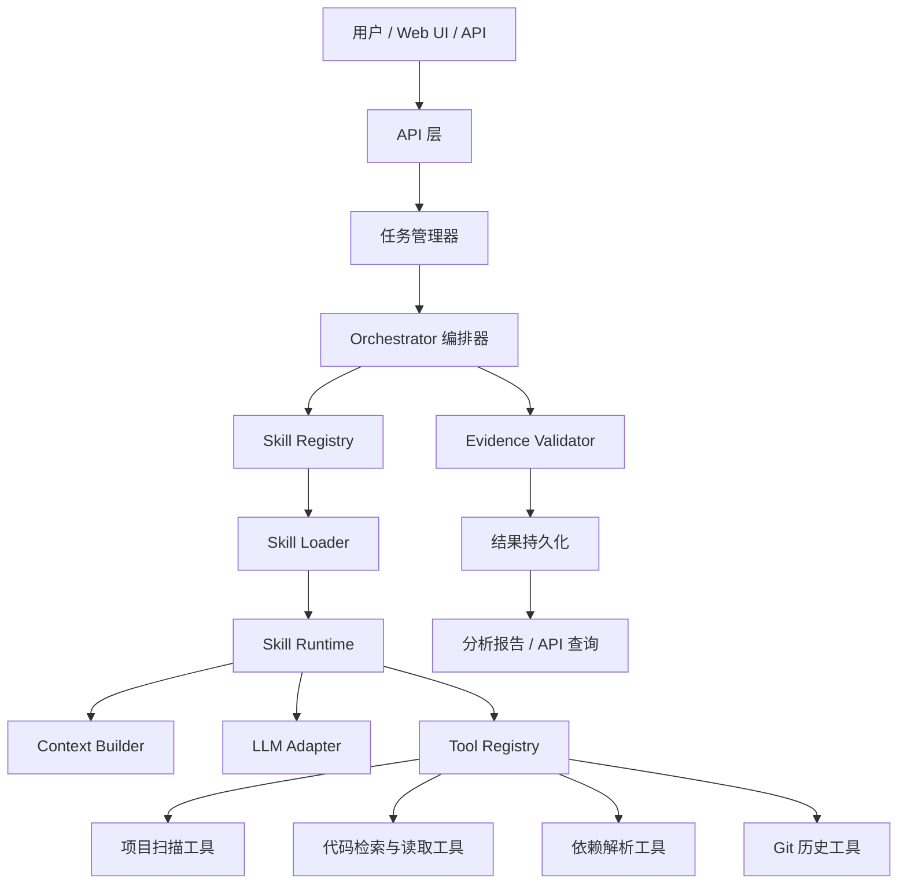
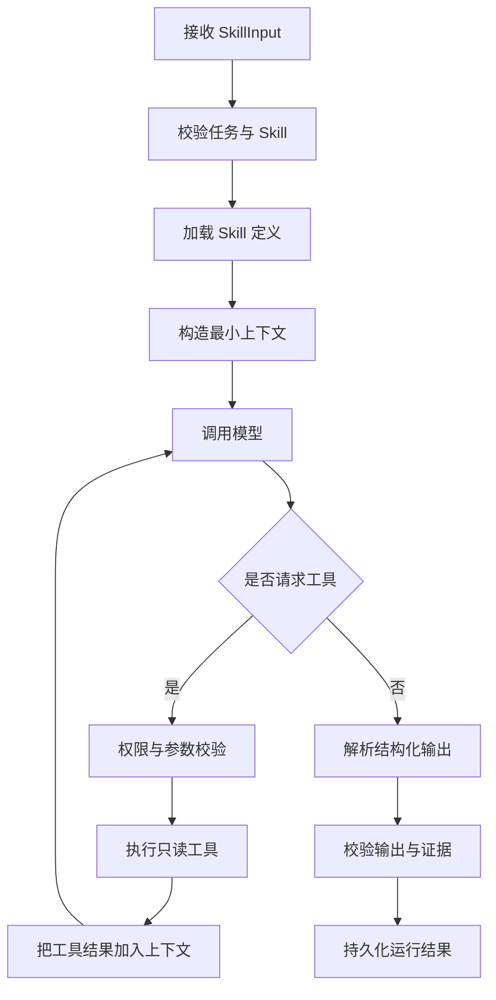
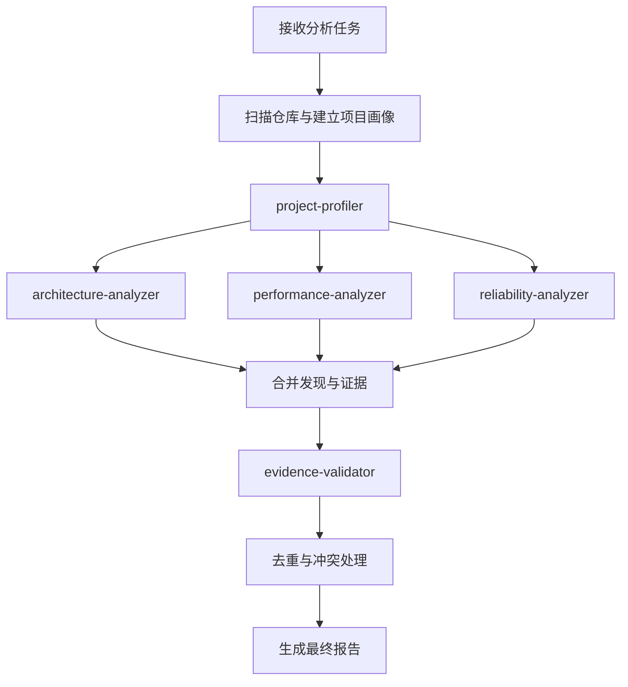

# DevSkill Analyzer：基于 Skills 的代码仓库分析 Agent

> 文档类型：技术设计方案  
> 版本：V1.0  
> 项目定位：面向代码仓库的技术架构分析与技术亮点挖掘 Agent  
> 核心原则：**结论有证据、事实与推断分离、执行过程可控、结果可评估**

---

## 1. 项目背景与目标

### 1.1 项目背景

在阅读和分析一个陌生代码仓库时，开发者通常需要手动完成以下工作：

- 识别项目使用的语言、框架、依赖和基础设施。
- 理解目录结构、模块边界、核心调用链和数据流。
- 发现缓存、批处理、异步消息、并发控制等技术设计。
- 分析幂等性、重试、超时、异常处理和数据一致性。
- 从源码、配置、测试和 Git 历史中提取可验证的技术亮点。
- 区分代码中确实存在的机制、基于代码作出的推断，以及仍需验证的结论。

这些工作往往耗时较长，也容易因为只阅读局部代码而遗漏上下文。普通的单轮大模型问答虽然可以快速生成分析结果，但通常缺少稳定的执行流程、工具权限控制、证据追踪和质量评估机制。

### 1.2 项目目标

DevSkill Analyzer 是一个使用 Skills 组织专业分析流程的代码仓库分析 Agent。用户提供一个本地 Git 仓库或已登记的项目后，系统通过代码检索、文件读取、依赖解析、Git 历史分析等工具，调用不同的 Skill 完成分析，并输出带有证据引用的结构化结果。

核心目标：

1. **项目画像**：识别语言、框架、依赖、模块与基础设施。
2. **架构分析**：梳理模块关系、调用链、关键数据流。
3. **技术亮点挖掘**：识别缓存、批处理、异步处理、并发控制、性能优化等代码机制。
4. **可靠性分析**：检查幂等、重试、超时、异常处理和一致性设计。
5. **证据校验**：确保结论能关联到具体文件、代码行、配置或测试。
6. **可评估性**：使用固定测试仓库和标注结果衡量分析质量。

### 1.3 非目标

第一版不以以下内容为核心：

- 自动生成或润色简历。
- 自动修改用户仓库代码或提交代码。
- 直接执行任意 Shell 命令。
- 一开始就构建复杂的多 Agent 自主协作系统。
- 一开始就引入向量数据库、知识图谱或消息队列。
- 将代码中存在某种机制直接等同于已经获得性能收益或线上效果。

简历素材整理可以作为后续的输出形式，但不属于项目核心能力。

---

## 2. 设计原则

### 2.1 Skill 与 Runtime 分离

Skill 负责描述“如何完成某类分析”，Runtime 负责“如何安全、稳定地执行分析”。

- Skill：分析目标、步骤、约束、输出要求、可用工具。
- Runtime：加载 Skill、构造上下文、调用模型、执行工具、控制循环、校验输出。
- Tool：提供确定性的外部能力，例如读取文件、搜索代码、解析依赖。
- Orchestrator：组织多个 Skill 的执行顺序、并行关系和结果汇总。

### 2.2 渐进式加载

不要在每次请求中把所有 Skill、参考资料和脚本全部塞进模型上下文。

1. 发现阶段：只加载 Skill 的名称、描述、标签等元数据。
2. 激活阶段：加载被选中的完整 `SKILL.md`。
3. 按需阶段：仅在 Skill 指示需要时加载 `references/` 中的参考资料。
4. 工具阶段：需要确定性证据时，通过受控工具读取源码或执行分析脚本。

### 2.3 证据优先

每条重要发现都应尽可能关联证据：

- 文件路径。
- 起止行号。
- 关键符号或函数名。
- 必要时保留短代码片段。
- 仓库版本或提交 SHA。
- 文件内容哈希，便于判断证据是否仍然有效。

证据只能证明其实际支持的内容。例如，代码中存在批量消费逻辑，可以证明系统实现了批量处理，但不能仅凭这段代码断言吞吐量提高了多少。

### 2.4 事实、推断和待验证项分离

推荐为发现设置明确的状态：

- `verified`：证据直接支持该描述。
- `inferred`：基于已有证据作出的合理推断，需明确推断依据。
- `needs_review`：证据不足，或需要运行测试、查看运行数据才能判断。
- `contradicted`：发现与现有证据冲突，需人工复核。

不要把“可能存在风险”写成“线上已经发生故障”，也不要把“代码实现了重试”写成“重试机制一定有效”。

### 2.5 默认只读与最小权限

第一版只开放只读仓库工具。仓库内容、注释、README 和 Skill 参考文件都属于不可信输入，不能通过其中的指令覆盖 Runtime 的安全策略或扩大工具权限。

---

## 3. 总体架构



### 3.1 核心模块职责

| 模块 | 职责 |
|---|---|
| API 层 | 接收项目登记、分析任务创建、任务状态和结果查询请求 |
| 任务管理器 | 创建任务、管理状态、处理取消和失败 |
| Orchestrator | 组织 Skill 的执行顺序、并行任务、依赖和结果汇总 |
| Skill Registry | 发现 Skill、管理元数据、检查重名和状态 |
| Skill Loader | 加载完整 Skill 内容及按需引用的资源 |
| Skill Runtime | 执行单个 Skill 的模型与工具循环，控制预算和超时 |
| Context Builder | 构造最小且相关的项目上下文，限制 Token 使用 |
| LLM Adapter | 屏蔽模型供应商差异，统一请求、结构化输出和错误处理 |
| Tool Registry | 注册工具、检查权限、提供工具定义 |
| Evidence Validator | 校验发现的证据是否存在、是否匹配、是否足以支撑结论 |
| Storage | 保存项目、任务、运行记录、证据和分析结果 |

### 3.2 推荐技术栈

| 层次 | 第一版建议 | 说明 |
|---|---|---|
| 后端 | Go + go-zero | 与项目的 Go 技术方向一致，适合任务编排与 API |
| 前端 | Vue 3 + TypeScript（可选） | 用于任务状态、发现列表和证据查看 |
| 数据库 | PostgreSQL | 保存任务、Skill 运行记录、发现和证据 |
| 代码分析 | 文件扫描、正则/符号检索、语言专用 AST | 先做可解释的确定性分析，再逐步增加语义分析 |
| 模型接入 | 统一 LLM Adapter | 支持结构化输出和工具调用 |
| 测试 | Go 单元测试、集成测试、固定样例仓库 | 质量评估必须可重复 |
| 部署 | 本地运行或 Docker Compose | 第一版不要求复杂集群 |

Redis、消息队列、向量数据库和多 Agent 框架均可后续按实际瓶颈引入，不应作为第一版的前置依赖。

---

## 4. 项目目录结构

建议从一开始区分运行时框架代码、Skill 定义和评估用例。

```text
devskill-analyzer/
├── cmd/
│   └── server/
│       └── main.go
├── internal/
│   ├── api/                  # HTTP API
│   ├── task/                 # 任务创建、状态和取消
│   ├── orchestrator/         # 多 Skill 编排
│   ├── skill/
│   │   ├── registry.go       # Skill 发现与索引
│   │   ├── loader.go         # Skill 加载
│   │   ├── parser.go         # SKILL.md 元数据解析
│   │   ├── matcher.go        # Skill 匹配
│   │   └── runtime.go        # Skill 执行生命周期
│   ├── context/              # 上下文构建与 Token 预算
│   ├── llm/                  # 模型适配层
│   ├── tool/
│   │   ├── registry.go
│   │   ├── project_tree.go
│   │   ├── project_detect.go
│   │   ├── code_search.go
│   │   ├── code_read.go
│   │   ├── code_references.go
│   │   └── git_log.go
│   ├── evidence/              # 证据模型与采集
│   ├── validator/             # 输出和证据校验
│   ├── storage/               # 数据持久化
│   └── config/
├── skills/
│   ├── project-profiler/
│   │   ├── SKILL.md
│   │   └── references/
│   ├── architecture-analyzer/
│   │   ├── SKILL.md
│   │   └── references/
│   ├── performance-analyzer/
│   │   └── SKILL.md
│   ├── reliability-analyzer/
│   │   └── SKILL.md
│   └── evidence-validator/
│       └── SKILL.md
├── configs/
├── tests/
│   ├── unit/
│   ├── integration/
│   └── evals/
│       ├── repositories/
│       ├── cases/
│       └── expected/
├── docs/
├── go.mod
└── README.md
```

`skills/` 中的内容应尽可能作为独立的声明式资产管理。新增一种分析能力时，理想情况下只需新增或调整 Skill 文件与必要的工具，不需要修改 Runtime 主流程。

---

## 5. Skill 文件规范

### 5.1 基本格式

采用 Markdown 正文加 YAML Front Matter 的方式描述 Skill。下面的字段是本项目约定，并不意味着所有外部 Skills 实现都支持相同字段。

```markdown
---
name: reliability-analyzer
description: >
  分析代码仓库的可靠性设计，包括消息幂等、重试、
  超时、异常处理和数据一致性。
version: 1.0.0
tags:
  - reliability
  - messaging
  - backend
allowed-tools:
  - project.tree
  - code.search
  - code.read
  - code.references
  - git.log
---

# 可靠性分析 Skill

## 目标

识别仓库中与可靠性相关的代码机制，并给出有证据支持的分析结果。

## 分析步骤

1. 识别消息队列、数据库、缓存和外部服务等关键依赖。
2. 搜索重试、超时、幂等、事务、去重和异常处理相关代码。
3. 读取相关函数及其调用上下文。
4. 检查是否有测试、配置或调用方逻辑支持结论。
5. 将发现分为已验证、推断和待验证项。

## 输出要求

每条发现必须包含标题、说明、状态和证据引用。

## 约束

- 不得仅凭函数名判断功能已经正确实现。
- 不得将潜在风险描述为已经发生的线上事故。
- 证据不足时标记为待验证。
- 不得修改仓库文件。
- 不得尝试读取仓库根目录之外的文件。
```

### 5.2 第一批 Skills

#### `project-profiler`

目标：建立仓库画像。

主要任务：

- 识别语言、框架、构建工具和依赖。
- 识别入口文件、配置文件、数据库迁移文件和测试目录。
- 概括主要目录与模块职责。
- 输出尚未确认的技术栈信息。

#### `architecture-analyzer`

目标：分析模块边界、调用关系和数据流。

主要任务：

- 找出应用入口、路由、Handler、Service、Repository/Model 等关键层。
- 追踪典型请求或消息的调用路径。
- 识别模块依赖和关键外部系统。
- 使用路径、符号和行号支撑架构结论。

#### `performance-analyzer`

目标：发现与性能相关的实现机制。

重点检查：

- 缓存和缓存失效。
- 批量读写、批处理和减少重复查询。
- 并发、连接池、限流和缓冲区。
- 慢查询风险、N+1 查询和不必要的重复计算。
- 需要基准测试或运行数据才能确认的性能假设。

#### `reliability-analyzer`

目标：分析可靠性和数据一致性机制。

重点检查：

- 消息重复投递与幂等处理。
- 重试、退避、超时和熔断。
- 事务边界和跨系统一致性。
- 错误传播、异常处理和资源释放。
- 消费失败、补偿和死信处理。

#### `evidence-validator`

目标：检查前序 Skill 输出是否有足够证据支持。

主要任务：

- 验证文件和行号是否存在。
- 检查引用片段与结论是否相关。
- 检查结论是否超出证据支持范围。
- 发现重复、矛盾或表述过强的结论。
- 对证据不足的发现降级或标记为待人工复核。

---

## 6. Skill Registry 与 Loader

### 6.1 Registry 职责

Registry 负责发现和索引 Skill，不负责实际执行模型调用。

建议接口：

```go
type SkillMetadata struct {
    Name         string
    Description  string
    Version      string
    Tags         []string
    AllowedTools []string
}

type SkillDefinition struct {
    Metadata SkillMetadata
    Body     string
    RootDir  string
}

type Registry interface {
    Discover(ctx context.Context) error
    Get(name string) (*SkillDefinition, error)
    List() []SkillMetadata
    Refresh(ctx context.Context) error
}
```

### 6.2 加载流程

1. 扫描配置指定的 Skill 根目录。
2. 查找每个子目录中的 `SKILL.md`。
3. 解析 Front Matter 与 Markdown 正文。
4. 校验必填字段、名称格式、版本和工具白名单。
5. 检查重复名称和无效引用。
6. 构建新的索引快照。
7. 校验成功后原子替换旧索引，避免刷新过程中出现半更新状态。

### 6.3 安全要求

- Skill 资源路径必须限制在 Skill 根目录内，防止路径穿越。
- 对 `allowed-tools` 做服务端权限校验，不能只把它作为提示词告诉模型。
- 生产运行时不应自动执行 Skill 目录中的任意脚本。
- 解析错误应明确报告 Skill 名称和错误原因。
- 刷新失败时保留上一份有效索引。

### 6.4 Matcher：Skill 匹配

建议采用“规则筛选 + 可选模型选择”的两阶段方式：

1. 根据用户任务类型、项目语言、标签和依赖，筛选候选 Skill。
2. 当候选项较多或任务意图复杂时，让模型从候选列表中选择。
3. 服务端检查 Skill 是否存在、是否启用、工具权限是否满足。
4. 无匹配结果时返回明确提示，或使用经过定义的默认分析流程。

不要让模型任意编造 Skill 名称，也不要将所有路由决策都交给模型。

---

## 7. Tool Registry 与代码工具

Skill 描述分析方法；Tool 提供确定性的执行能力。第一版应优先实现只读工具。

### 7.1 第一批工具

| 工具 | 功能 | 约束 |
|---|---|---|
| `project.tree` | 获取仓库目录树 | 排除 `.git`、构建产物和大型依赖目录 |
| `project.detect` | 识别语言、框架、依赖与基础设施 | 基于配置文件和明确规则 |
| `code.search` | 搜索关键词、符号或模式 | 限制结果数、文件类型和返回长度 |
| `code.read` | 读取指定文件或行范围 | 校验路径、限制最大字节数 |
| `code.references` | 查找符号的引用位置 | 第一版可使用文本/语言专用索引，逐步增强 |
| `git.log` | 查看提交记录和文件变更 | 默认只读，限制提交数量和输出长度 |

后续可按需加入：

- `test.run`：执行指定测试命令。
- `dependency.inspect`：解析依赖版本和依赖关系。
- `ast.inspect`：通过语言 AST 获取函数、类型和调用信息。

### 7.2 Tool 接口

```go
type ToolSpec struct {
    Name        string
    Description string
    InputSchema json.RawMessage
}

type ToolCall struct {
    ID        string
    Name      string
    Arguments json.RawMessage
}

type ToolResult struct {
    CallID  string
    Content json.RawMessage
    IsError bool
}

type Tool interface {
    Spec() ToolSpec
    Execute(ctx context.Context, input json.RawMessage) (ToolResult, error)
}

type ToolRegistry interface {
    Register(tool Tool) error
    Get(name string) (Tool, bool)
    List() []ToolSpec
}
```

### 7.3 工具执行约束

每次工具调用至少需要：

1. 校验工具是否注册。
2. 校验当前 Skill 是否有权限使用该工具。
3. 校验参数是否符合 JSON Schema。
4. 校验路径、命令和资源边界。
5. 应用超时、输出大小和调用次数限制。
6. 记录工具名称、调用 ID、耗时、成功状态和错误摘要。
7. 对过长结果进行截断，并明确标记截断状态。

任意 Shell 执行属于高风险能力，第一版默认关闭。若后续支持测试执行，应使用命令白名单、隔离环境、资源限制和明确的用户授权。

---

## 8. Skill Runtime

### 8.1 Runtime 输入与输出

```go
type SkillInput struct {
    TaskID      string
    SkillName   string
    ProjectID   string
    UserRequest string
    Parameters  map[string]any
}

type SkillOutput struct {
    TaskID   string
    SkillName string
    Status   string
    Summary  string
    Findings []Finding
    Evidence  []EvidenceRef
    Warnings  []string
}

type SkillRuntime interface {
    Run(ctx context.Context, input SkillInput) (*SkillOutput, error)
}
```

### 8.2 执行生命周期



### 8.3 执行限制

必须设置并记录：

- 单次运行总超时。
- 单次运行模型调用次数上限。
- 单次运行工具调用次数上限。
- 单个工具超时。
- 上下文和输出 Token 预算。
- 模型请求的有限重试次数。
- 用户取消任务后的取消传播。
- 运行失败后的状态和错误记录。

建议任务状态统一为：

- `queued`
- `running`
- `succeeded`
- `failed`
- `cancelled`
- `needs_review`

模型输出必须经过结构化解析和服务端校验，不能直接把未校验的自然语言当成可信业务数据。

---

## 9. 多 Skill 编排

### 9.1 第一版采用显式流程

第一版不建议构建完全自由的自主 Agent。采用可观察、可测试的固定阶段和有限并行更容易控制质量与成本。



### 9.2 编排规则

- 项目画像通常先执行，为后续 Skill 提供语言、框架和目录上下文。
- 架构、性能、可靠性分析在资源允许时可以并行执行。
- 最终证据校验在分析结果合并后执行。
- 某个非关键 Skill 失败时，可以保留其他结果并标记部分失败。
- 关键阶段失败时，任务应进入失败或待复核状态。
- 结果合并时对相同证据、相同结论进行去重。
- 对相互矛盾的结论保留冲突信息，不要简单覆盖。
- 每个阶段都要记录输入摘要、输出、耗时和状态。

初期可以直接用 Go 代码定义 DAG；只有当流程需要频繁配置调整时，再考虑将工作流抽取为 YAML。

---

## 10. 证据与发现的数据模型

### 10.1 EvidenceRef

```go
type EvidenceRef struct {
    ID           string `json:"id"`
    SourceType   string `json:"source_type"`
    Path         string `json:"path"`
    StartLine    int    `json:"start_line,omitempty"`
    EndLine      int    `json:"end_line,omitempty"`
    Symbol       string `json:"symbol,omitempty"`
    Snippet      string `json:"snippet,omitempty"`
    ContentHash  string `json:"content_hash,omitempty"`
    CommitSHA    string `json:"commit_sha,omitempty"`
}
```

`SourceType` 可包括 `source_code`、`config`、`test`、`git_history` 等。

### 10.2 Finding

```go
type Finding struct {
    ID              string   `json:"id"`
    Category        string   `json:"category"`
    Title           string   `json:"title"`
    Description     string   `json:"description"`
    Status          string   `json:"status"`
    EvidenceIDs     []string `json:"evidence_ids"`
    Limitations     []string `json:"limitations,omitempty"`
    Recommendations []string `json:"recommendations,omitempty"`
}
```

建议的 `Category`：

- `architecture`
- `performance`
- `reliability`
- `data_consistency`
- `engineering_practice`
- `dependency`

建议的 `Status`：

- `verified`
- `inferred`
- `needs_review`
- `contradicted`

### 10.3 证据校验规则

- 引用文件必须位于允许分析的仓库范围内。
- 行号必须有效，文件变更后应重新校验。
- 结论必须关联至少一条证据，除非它被明确标记为待验证。
- 证据片段不能被任意改写成不存在的源码内容。
- 结论强度不得超过证据支持的范围。
- 性能收益、线上故障和实际业务效果需要基准测试、监控或其他运行证据，不能只从静态代码推导。
- 对同一文件的不同提交版本，必须记录提交 SHA 或内容哈希，避免引用错位。

---

## 11. 数据库设计建议

第一版可以使用 PostgreSQL。下列是逻辑表建议，具体字段、索引和约束可在实现时进一步细化。

### 11.1 `project`

保存登记的仓库信息。

| 字段 | 含义 |
|---|---|
| `id` | 项目 ID |
| `name` | 项目名称 |
| `repo_path` | 服务端允许访问的仓库路径或受控仓库标识 |
| `default_branch` | 默认分支 |
| `created_at` | 创建时间 |
| `updated_at` | 更新时间 |

注意：不要允许用户传入任意路径后直接读取。应使用配置的仓库根目录、项目登记机制和路径校验限制访问范围。

### 11.2 `analysis_task`

保存分析任务。

| 字段 | 含义 |
|---|---|
| `id` | 任务 ID |
| `project_id` | 项目 ID |
| `status` | 任务状态 |
| `request_json` | 用户请求和参数 |
| `commit_sha` | 本次分析对应的代码版本 |
| `started_at` | 开始时间 |
| `finished_at` | 完成时间 |
| `error_message` | 错误摘要 |
| `created_at` | 创建时间 |

### 11.3 `skill_run`

保存每个 Skill 的执行记录。

| 字段 | 含义 |
|---|---|
| `id` | 运行 ID |
| `task_id` | 所属任务 |
| `skill_name` | Skill 名称 |
| `skill_version` | Skill 版本 |
| `status` | 运行状态 |
| `input_summary` | 输入摘要 |
| `output_json` | 结构化输出 |
| `model_name` | 使用的模型 |
| `token_usage` | Token 使用情况 |
| `duration_ms` | 耗时 |
| `error_message` | 错误摘要 |

### 11.4 `evidence`

保存证据记录，包括来源类型、路径、行号、符号、片段、提交 SHA 和内容哈希。

### 11.5 `finding`

保存分析发现，包括分类、标题、描述、状态、局限性和建议。

### 11.6 `finding_evidence`

建立发现与证据之间的多对多关系。

| 字段 | 含义 |
|---|---|
| `finding_id` | 发现 ID |
| `evidence_id` | 证据 ID |
| `relation_type` | 支持、反驳或补充 |

### 11.7 `evaluation_run`（可选）

保存评估集版本、模型版本、Skill 版本、各项指标和对比结果。

### 11.8 数据一致性建议

- 每个分析任务固定对应一个代码版本。
- Skill 运行记录保存 Skill 版本，便于复现。
- 证据和发现通过外键或应用层约束关联。
- 任务状态更新应避免并发覆盖。
- 对长任务采用异步任务与轮询，不需要一开始就上消息队列。

---

## 12. API 设计

第一版可以使用 REST API，任务采用异步执行。

### 12.1 创建项目

`POST /api/projects`

请求示例：

```json
{
  "name": "xiaohongshu",
  "repoPath": "/srv/repos/xiaohongshu"
}
```

服务端必须验证路径位于允许访问的仓库根目录内。

### 12.2 创建分析任务

`POST /api/projects/{projectId}/analysis-tasks`

请求示例：

```json
{
  "analysisTypes": [
    "architecture",
    "performance",
    "reliability"
  ],
  "branch": "main"
}
```

响应示例：

```json
{
  "taskId": "task_xxx",
  "status": "queued"
}
```

### 12.3 查询任务状态

`GET /api/analysis-tasks/{taskId}`

返回任务状态、阶段进度、开始时间、结束时间和错误摘要。

### 12.4 查询发现列表

`GET /api/analysis-tasks/{taskId}/findings`

支持按分类、状态和关键词筛选。

### 12.5 查询发现证据

`GET /api/findings/{findingId}/evidence`

返回相关文件、行号、符号、代码片段、提交 SHA 和内容哈希。

### 12.6 查询 Skill 列表

`GET /api/skills`

返回 Skill 名称、描述、版本、标签和启用状态，不应泄漏服务端密钥或内部敏感配置。

### 12.7 刷新 Skill

`POST /api/admin/skills/refresh`

该接口应限制为管理员使用。刷新失败时保留上一份有效索引，并返回可诊断的错误信息。

---

## 13. 安全与可靠性

### 13.1 仓库访问安全

- 所有文件访问都必须限制在登记的仓库根目录内。
- 规范化路径后检查是否越界。
- 处理符号链接，防止通过链接访问仓库外部文件。
- 排除密钥文件、凭证文件和大型二进制文件；必要时支持可配置的排除规则。
- 对输出中的密钥、令牌和个人信息进行脱敏。
- 不将未经授权的私有代码发送给外部模型；模型调用前应明确配置数据处理策略。

### 13.2 Prompt Injection 防护

源码、注释、README、配置文件和 Skill 参考资料可能包含试图操纵模型的内容。Runtime 必须坚持以下规则：

- 仓库内容只作为待分析数据，不作为更高优先级的系统指令。
- 工具权限由服务端校验，不由模型或仓库文本决定。
- 不允许通过文件内容触发任意命令执行。
- 对工具调用设置数量、时长和输出限制。
- 记录异常工具请求，便于审计。

### 13.3 故障处理

- 模型超时或限流时使用有限重试与退避。
- 工具错误应作为结构化错误返回给 Runtime。
- 非关键 Skill 失败时保留其他成功结果。
- 输出解析失败时允许有限次数的修复请求；超过上限则标记失败。
- 用户取消任务时应尽可能取消正在进行的模型和工具调用。
- 每个任务必须有最终状态，避免永久停留在 `running`。

---

## 14. 测试与评估体系

### 14.1 单元测试

重点覆盖：

- Front Matter 解析和字段校验。
- Skill 重名、缺失字段和无效引用。
- 路径穿越与符号链接边界。
- Tool Registry 注册、权限和参数 Schema 校验。
- Runtime 超时、取消、调用次数限制。
- 证据行号与内容哈希校验。
- 结构化输出解析与错误处理。

### 14.2 集成测试

使用 Mock LLM 和测试工具，验证：

- Skill 能够按预期完成工具调用循环。
- 未授权工具调用会被拒绝。
- 工具输出能够进入后续模型上下文。
- 多 Skill 失败时编排器可以正确处理。
- 最终报告能追溯到证据。
- 任务取消、超时和部分失败状态正确。

### 14.3 固定评估仓库

准备若干小型、可控、带已知事实的测试仓库，例如：

- 存在缓存逻辑的服务。
- 存在消息重复消费风险的服务。
- 存在批处理和并发控制的服务。
- 存在错误处理或事务边界问题的服务。
- 同时包含真实机制与容易误判代码的服务。

为每个仓库准备人工标注的预期发现和证据范围。评估集应随版本管理，确保不同模型、Prompt 和 Skill 版本之间可以公平对比。

### 14.4 核心评估指标

| 指标 | 含义 |
|---|---|
| Skill 匹配准确率 | 系统是否选择了适合任务的 Skill |
| 发现精确率 | 输出的发现中有多少得到人工确认 |
| 发现召回率 | 已标注的重要发现中有多少被系统识别 |
| 证据覆盖率 | 有有效证据关联的发现占比 |
| 无依据结论率 | 缺乏证据或超出证据范围的结论占比 |
| 任务完成率 | 成功完成的任务比例 |
| 平均耗时 | 单任务平均执行时间 |
| 平均成本 | 单任务 Token 与模型调用成本 |

### 14.5 对照实验

至少比较两种方案：

- **Baseline**：单个通用 Prompt，直接分析仓库摘要或选定文件。
- **DevSkill Analyzer**：Skills + 只读工具 + 结构化输出 + 证据校验。

对比时固定模型版本、测试集和评价标准。不要只用“报告更长”或“看起来更专业”作为效果提升的证据。

---

## 15. 开发路线

### 阶段一：Skill Registry 与 Loader

交付：

- Skill 目录约定。
- Front Matter 解析。
- 元数据校验。
- 重名检测和资源路径安全校验。
- Skill 列表与刷新能力。
- 单元测试。

验收标准：新增一个符合规范的 Skill 文件后，系统无需修改 Runtime 代码即可发现并读取它。

### 阶段二：Tool Registry 与 Runtime

交付：

- Tool 注册机制。
- 工具参数 Schema 校验。
- Skill 工具权限控制。
- LLM Adapter。
- 结构化输出。
- 超时、取消、调用预算和日志。

验收标准：Runtime 能执行一个 Skill 的完整模型—工具循环，并拒绝未授权工具调用。

### 阶段三：项目画像与核心分析

交付：

- 项目目录扫描。
- 技术栈识别。
- 代码搜索和读取。
- `project-profiler`。
- `architecture-analyzer`。
- `performance-analyzer` 和 `reliability-analyzer` 的初版。
- 带文件路径和行号的结构化发现。

验收标准：对一个固定仓库生成可追溯的项目画像和若干技术发现。

### 阶段四：多 Skill 编排与证据校验

交付：

- 显式工作流。
- 多 Skill 结果合并。
- 发现去重与冲突标记。
- `evidence-validator`。
- 任务状态与持久化。

验收标准：可以完整运行“扫描 → 分析 → 校验 → 报告”流程，且证据不足的结论不会被无条件标记为已验证。

### 阶段五：评估与 Web UI

交付：

- 固定测试仓库和标注集。
- 质量指标统计。
- Baseline 对照实验。
- 任务进度、发现列表和证据查看页面。
- Docker Compose 部署说明。

验收标准：能重复运行评估并比较不同 Skill 或模型版本的质量。

---

## 16. 第一版范围建议

为了控制复杂度，建议第一版只做：

- 本地登记仓库。
- 只读代码工具。
- Skill 元数据解析和动态加载。
- 单 Skill Runtime。
- 三类分析：项目画像、架构分析、可靠性/性能分析。
- 显式多 Skill 编排。
- 证据追溯和结构化报告。
- 固定测试仓库和基础评估。

暂缓：

- 向量数据库和通用 RAG。
- 任意 Shell 执行。
- 自动修复代码。
- 完全自主的多 Agent 协作。
- 分布式任务队列。
- 复杂的租户和权限管理系统。

当代码规模、检索质量或并发量出现明确瓶颈时，再针对性引入索引、向量检索、队列或更复杂的执行框架。

---

## 17. 项目亮点与技术价值

项目的技术亮点不应只停留在“调用了大模型”，而应体现在可验证的工程设计上：

1. **声明式 Skills 框架**：通过标准化的 Skill 定义组织专业分析流程，支持发现、加载、匹配和版本管理。
2. **受控的 Tool Calling**：工具注册、Schema 校验、权限控制、超时和调用预算由 Runtime 统一管理。
3. **显式多 Skill 编排**：将复杂任务拆解为可追踪、可测试的分析阶段，支持有限并行和部分失败处理。
4. **证据驱动的分析结果**：发现关联源码位置、提交版本和内容哈希，支持从结论回到原始证据。
5. **事实与推断分离**：通过状态和限制性说明降低大模型过度推断。
6. **可重复的评估体系**：使用固定仓库、标注证据和指标对比不同实现，而不是只依赖主观体验。
7. **安全边界清晰**：将仓库内容视为不可信输入，限制文件访问、工具调用和潜在命令执行。

这些能力都应通过代码、测试和评估结果证明，而不是仅在项目介绍中宣称已经实现。

---

## 18. 参考实现与后续研究方向

实现时建议重点研究开源 Skills 项目的以下方面：

- Skill 的元数据格式和发现机制。
- 主指令与参考资料的分离方式。
- 渐进式上下文加载。
- 工具调用的权限边界。
- Skill 编写、测试与评估的方法。
- 如何将可复用的流程知识与运行时机制分开。

可作为学习入口的项目：

- [Anthropic Skills](https://github.com/anthropics/skills)
- [OpenAI Skills](https://github.com/openai/skills)
- [VoltAgent Awesome Agent Skills](https://github.com/VoltAgent/awesome-agent-skills)
- [Superpowers](https://github.com/obra/superpowers)
- [Hugging Face Skills](https://github.com/huggingface/skills)

学习这些项目时，重点不是照搬某个目录结构，而是理解其约定，并结合本项目的工具权限、证据追溯、可观测性和评估需求进行取舍。

---

## 19. 总结

DevSkill Analyzer 的核心不是把多个 Prompt 放进目录，而是建立一套可维护、可控、可评估的 Skills 执行框架：

- 用 **Skill** 定义专业分析方法。
- 用 **Registry/Loader** 管理 Skill 的发现和加载。
- 用 **Tool Registry** 提供受控的代码分析能力。
- 用 **Runtime** 统一执行模型与工具循环。
- 用 **Orchestrator** 管理多阶段分析流程。
- 用 **Evidence Validator** 控制结论的可信度。
- 用 **Evaluation** 衡量分析质量。

建议从 Registry、Loader、Tool Registry 和单 Skill Runtime 开始，先跑通一个端到端的代码分析场景，再逐步扩展到多 Skill 编排、证据校验和评估系统。
